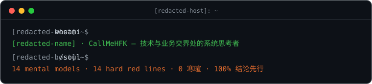

<div align="center">



<br>

**`CallMeHFK`** · UTC+8 · Agent 系统工程师

过程监督 / 输出路由 / 技能质量


<code></code>
<code></code>
<code></code>
<code></code>
<code></code>
<code></code>
<code></code>
<code></code>


</div>

## 仓库速览

| 仓库 | 是什么 | 版本 |
|---|---|---|
| [dispatch-guard](https://github.com/CallMeHFK/dispatch-guard) | 编排 Agent 输出路由的 tool-seam 中间件 | v0.1.11 |
| [agent-shepherd](https://github.com/CallMeHFK/agent-shepherd) | 智能体过程监督：两层检测器 + 离线反事实基准 | v0.4.0 |
| [jev-kernel](https://github.com/CallMeHFK/jev-kernel) | mu 式判定内核：tool seam 上的分级裁决与校准概率（上游移植适配） | v0.2.1 |
| [agent-task-callback](https://github.com/CallMeHFK/agent-task-callback) | 跨 Agent 后台任务的 push 侧回调 | v0.1.5 |
| [qwenpaw-secret-input](https://github.com/CallMeHFK/qwenpaw-secret-input) | 运行中途向人要密钥：明文不进模型上下文，只回一次性 ref | v0.2.0 |
| [qwenpaw-openviking](https://github.com/CallMeHFK/qwenpaw-openviking) | OpenViking 记忆服务的 QwenPaw 原生插件（上游移植适配） | v0.2.0 |
| [site-kg](https://github.com/CallMeHFK/site-kg) | 站点 URL 或本地目录 → 知识图谱 → 10 工具 MCP 服务 | — |
| [driveos-atlas](https://github.com/CallMeHFK/driveos-atlas) | DRIVE OS 7.0.3 文档镜像 → 可旋转的 3D 引用网络（纯静态） | — |
| [qwenpaw-consensus-rank](https://github.com/CallMeHFK/qwenpaw-consensus-rank) | 多评审 LLM 位次平均共识排序 | v1.4.10 |
| [niclane](https://github.com/CallMeHFK/niclane) | 本地 SOCKS5 / HTTP 代理的 per-NIC 出口隔离（Go，候选车道自动故障转移，fail-closed） | v0.4.0 |
| [sovereign-echo](https://github.com/CallMeHFK/sovereign-echo) | 把个人数据主权声明注入每一场对话（Shell） | — |
| [agent-chatroom](https://github.com/CallMeHFK/agent-chatroom) | 多 Agent 聊天室：@ 点名、并行应答、SSE 流式、共享画布 | — |
| [raspberry-pi](https://github.com/CallMeHFK/raspberry-pi) | 派上实时语音通话（WebRTC），后端是真能执行工具的 CLI agent | — |

行序与展厅卡片序一致，即 3D 星座的四个簇。

收例总数 **1,640**：Python 取 `pytest --collect-only -q`，Go 取 `func Test`，TypeScript 取 `node:test` 实跑。逐仓库为 dispatch-guard 210 + agent-shepherd 230 + jev-kernel 46 + agent-task-callback 33 + qwenpaw-secret-input 335 + qwenpaw-openviking 78 + site-kg 243 + qwenpaw-consensus-rank 120 + niclane 46 + agent-chatroom 299。site-kg 另有 2 项 `-m slow` 规模门禁被默认 deselect，故记 243 而非 245；**driveos-atlas 与 raspberry-pi 计 0**（前者没有测试，后者只有两个手工 e2e 脚本）；sovereign-echo 自带 `tests/run-tests.sh`，不进这个总数。

9 个仓库有 CI 且 HEAD 全绿，另 4 个（driveos-atlas、sovereign-echo、agent-chatroom、raspberry-pi）没有工作流。qwenpaw-secret-input 的 CI 只跑静态门（`ruff` + `compileall` + `node --check`），335 条 unittest 要 import 宿主包，只在本地跑。全部数字对 **2026-10-22** 复核。

## 系统设计

只展开自己从零写的三个系统；宿主插件与上游移植走上表，不占这一节。

### [agent-shepherd](https://github.com/CallMeHFK/agent-shepherd) — 过程监督

观测 QwenPaw / Claude Code / Codex 的 reasoning 与 tool call 流，偏航时注入纠正。

- Tier 0 确定性检测器：loop、regression、越权编辑、binding drift、context rot，加一路 CUSUM 漂移告警。Tier 1 是 PRM 式 LLM 判定，只在 natural checkpoint 或 CUSUM 逼近告警线时唤醒。
- 漂移阈值由蒙特卡洛仿真标定到会话级 FP 预算，判定阈值由 conformal risk control 按实测拟合；工具结局先做结构化证据三态分类（failed / ok / unknown），错误串文法只当 fallback。规则本条目按 Wilson 下界排序，不用 rate × log n。
- `shepherd eval` 单点注故障，按检测器报 precision / recall / detection latency / supervision cost，CI 以 `--fail-under-f1 0.8` 当门。
- 0.4.0 把判定层接回规则本：每条真正注入的纠偏留待下次 judge review，按当时的准入线标 agreed / disagreed；条目排序按 adherence 与该贴否率的收缩 Wilson 下界混合（w = n/(n+4)，单次意见最多动两成），累计 ≥4 次且贴否过半的条目直接从 header 剔除——缺 scorer 或缺 review 不算投票，标签只等真实的 review。`policy.rulebook_judge_feedback` 关这条通道。
- `shepherd uninstall <claude|codex|qwenpaw|all>` 只删安装写进去的条目，改前备份，`--dry-run` 出计划；`shepherd stop` 按 `/health` 报的 pid 与归属分拣手动进程与 systemd unit，不再让用户自己找进程。

### [dispatch-guard](https://github.com/CallMeHFK/dispatch-guard) — 输出路由

把派发约束从 system prompt 移到 tool seam：`on_acting` 拦截交付物形状的写入并 deny，回填该派给谁。

- 写入按交付物目录 / 扩展名 + 白名单判定；shell 侧默认 warn，`shell_enforce` 才堵重定向旁路；`spawn_subagent` 是 config 层关停之外的兜底 deny。读与基础文件 IO 不拦。
- `routes.json` 按 mtime 热加载并自审矛盾规则、死规则、未知 mode；无配置时从各 agent 声明的派发策略草拟 warn 模式的 `routes.draft.json`，改名才生效。
- `jev` 是 opt-in 的第二层，默认关：只补确定性规则判不出的两处——草拟路由时的 P0，和关键词路由指不到在册 owner 的 P1 盲区（原先静默 pass）。p ≥ 0.85 才在 enforce 下 deny 并点名 owner，0.6 到 0.85 转 warn，其余走原路径；L1 命中和清单读取失败分支零判定调用。判定端点与模型取自内核插件自己的 `jev.json`（`inherit:jev-kernel`），并以它的总开关为准——kernel 停了这层也停；客户端是纯标准库的协议镜像。

### [agent-chatroom](https://github.com/CallMeHFK/agent-chatroom) — 多 Agent 运行时

用户与多个 CLI agent 同室互聊：@ 点名，agent 之间也能互相唤起。零框架 `node:http` + SSE，前端单页零构建。

- 和 dispatch-guard 同一条主张：**回复路由是策略层，不写在 prompt 里**。@ 精确点名、无 @ 全员接力、`replyTo` 链深 ≤ 3 防无限对轰、发言冷却防抢话；并行应答默认开，同一轮被点名的多个 agent 同时发言，流式事件天然交错。
- 三种 driver 并存（ACP 常驻会话 / 本地一次性 CLI / 远程 SSH），所以「本机已装的各家 agent」不必先被改造成同一个协议才能进屋。abort 是一等公民：`Driver.send` 第三个参数就是 `AbortSignal`，acp 发 `session/cancel`，cli / ssh 杀进程组。
- SSE 事件对齐 AG-UI 分类法（`TEXT_MESSAGE_*` / `THINKING_*` / `CUSTOM` / `STATE_*`），**字段名本身就是前后端契约**——PLAN.md 的 T8–T12 标题直接写着「前端契约已定，字段不得更改」。
- 探针结论落进实现而不是留在脑子里：ACP SDK ^1.8.0 驱动 qodercli 时**默认不能调 `authenticate`**（会挂起），要直接 `session/new`，只在失败且 `authMethods` 非空时回退一次；2026-10-16 实测国际版端点 `*.qoder.sh` 被 TLS 拦截，改用国内版 qoderclicn。
- `docs/ISSUES.md` 是一份编号到 #43 的外部评审台账，37 行里 **25 fixed · 3 deferred · 9 open**；open 的 9 条连「本轮不修」的理由与剩余 scope 都写在表里，其中 `#39` 是 P1（会话 cookie 等价管理员权限，已做响应脱敏的最小止血，管理面加锁明确留待后续）。`#42` 记的是自己的门禁盲区，批注写着「两条都要配真破坏的负对照，否则是空门」。

299 项测试实跑全绿（`node:test`，2.25s）· 16,153 行 TS/JS（不含 vendor）· `package.json` 写 0.1.0 但未打 tag · 仓库无 LICENSE、无 CI——两条都记在展厅详情页的边界里。

## 上游 PR

| 仓库 | PR | 状态 | 内容 |
|---|---|---|---|
| [skillsgate](https://github.com/skillsgate/skillsgate) | [#31](https://github.com/skillsgate/skillsgate/pull/31) | merged 2026-10-12 | 投递 Qoder / Qoder CN / QwenPaw / ZCode 四个宿主，+47/−5 |
| [sepia](https://github.com/Nanako0129/sepia) | [#289](https://github.com/Nanako0129/sepia/pull/289) | merged 2026-10-09 | 零 Skill 安装改为显式失败，撤掉 `/sepia` 命令，+199/−171 |
| [sepia](https://github.com/Nanako0129/sepia) | [#250](https://github.com/Nanako0129/sepia/pull/250) | merged 2026-09-17 | `.qwenpaw-plugin/` 插件包 + `/sepia` 斜杠命令，+318/−25 |
| [ncdownloader](https://github.com/shiningw/ncdownloader) | [#158](https://github.com/shiningw/ncdownloader/pull/158) | merged 2024-06-06 | 修复「搜索音乐」条目下载失败（issue #136），+1/−1 |
| [nacos](https://github.com/alibaba/nacos) | [#12127](https://github.com/alibaba/nacos/pull/12127) | merged 2024-06-03 | Python services sample，+198/−2 |
| [SemaPLC](https://github.com/midea-ai/SemaPLC) | [#6](https://github.com/midea-ai/SemaPLC/pull/6) | open | QwenPaw / Claude Code / Cursor 三平台接入 |
| [ResearchStudio](https://github.com/microsoft/ResearchStudio) | [#60](https://github.com/microsoft/ResearchStudio/pull/60) | open | 安装器并列加 QwenPaw 与 Qoder 两个宿主 |
| [text-to-cad](https://github.com/earthtojake/text-to-cad) | [#429](https://github.com/earthtojake/text-to-cad/pull/429) | open | README 与首页补 ZCode / QwenPaw 安装路径 |

同一套 Skill 内容不动，只改 manifest 与路由。数字与状态对 2026-10-22 的 GitHub 复核（8 条逐个查过 state 与 merged_at）。

## 闭源与内部

<details>
<summary>三个不公开的条目</summary>

- **[redacted-project] MCP Server** — 截屏与鼠标键盘注入的 MCP 工具集，stdio / HTTP / SSE 三种 transport，`mouse_click` 与 `key_press` 带 duration 参数
- **Windows capture APO** — WDK `CBaseAudioProcessingObject` + ATL，[redacted-module] 回声消除后接自研因果流式降噪核（DD-Wiener / MCRA，无前瞻）；audiodg 内 CPU 用户态实时运行，不经 DSP/NPU offload
- **[redacted-project]** — AgentScope Agent Team：Leader 编排多类 Worker，配领域 Skill、长期记忆中间件与多租户隔离

</details>

## 图解

<details>
<summary>技能循环与决策边界</summary>


技能侧按带 `SKILL.md` 的目录安装，配 9 维评分与门控优化，评分口径参照 SkillLens 的实证基线。

</details>

## 运行原则

用数据与事实做决策，不用感觉。先盘点再行动，确认了快速推进。质量是底线，效率是目标。

```console
CallMeHFK:~$ cat principles.txt
[0] 先盘点，再行动      建立基线 → 改进 → 对比基线，不盲目启动
[1] 数据驱动不迷信      源码 > 配置 > 运行态；禁止口算，工具算完再输出
[2] 逐字保真            源数据神圣不可改；可加标注，禁止「优化」改写
[3] 物理极限即边界      参数调优空间可迭代，碰物理上限立即转向，不死磕
[4] 诚实纠错            新数据推翻旧结论 → 明确记录「上一轮我说 X 是错误的」
[5] 工具链即基础设施    按任务安装不膨胀；必须有退路，否则不上
```

---

<div align="center">

*「写得进去的部分，已经足够强大。」—— 但做不出来，比说不清楚更致命。*

</div>
